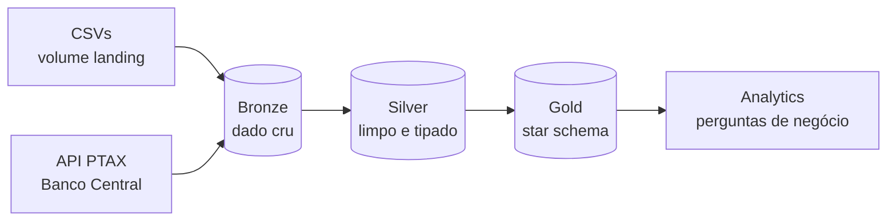
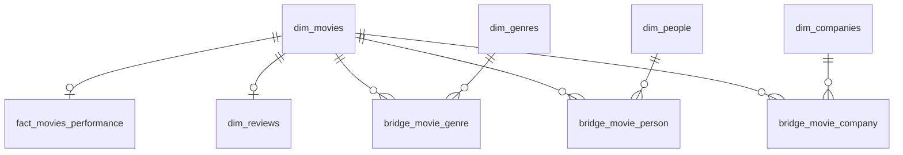

# CineData Analytics — Arquitetura Medalhão no Databricks

Projeto da Tarefa 2 do mini-curso Visagio Rocket Lab. Um pipeline de dados em **PySpark + Delta Lake** no Databricks (Unity Catalog) transforma bases brutas de filmes (TMDB/IMDb) e a cotação do dólar do Banco Central em um **modelo dimensional (star schema)**, pronto para consumo de BI e para análises de negócio.

## Escopo

- **Ingestão** de cinco arquivos CSV com informações de filmes (metadados, financeiro, métricas de engajamento, créditos e avaliações de usuários), mais a cotação PTAX do dólar via API do Banco Central.
- **Tratamento e padronização** de dados com problemas reais de qualidade: duplicatas, formatos de data mistos, separadores inconsistentes, valores monetários em texto (`$`, `USD`, `12.6K`), erros de escala e deslocamento de colunas (*column shift*).
- **Conversão financeira** de USD para BRL e cálculo de lucro e margem.
- **Modelagem dimensional** com chaves substitutas, tabelas ponte para atributos multivalorados e uma tabela fato com grão validado.
- **Validação analítica** do modelo por meio de perguntas de negócio.

## Arquitetura

Tudo fica no catálogo `cinedata_medallion`, com um schema por camada:

| Camada | Schema | Conteúdo |
|---|---|---|
| Bronze | `cinedata_medallion.bronze` | Dados como vieram da origem, com o timestamp da ingestão. Modo `append`. |
| Silver | `cinedata_medallion.silver` | Dados limpos, tipados, deduplicados e com colunas em português. Modo `overwrite`. |
| Gold | `cinedata_medallion.gold` | Dimensões, pontes e fato do star schema. Modo `overwrite`. |

## Notebooks

| # | Notebook | O que faz |
|---|---|---|
| 1 | `CineData_organization` | Cria o catálogo, os schemas `bronze`, `silver` e `gold`, e o volume `bronze.landing`, onde ficam os CSVs. |
| 2 | `CineData_bronze` | Lê os CSVs do volume e grava uma tabela Delta para cada um, sem alterar o conteúdo. Extrai a cotação do dólar da API do Banco Central para o período definido nos widgets (`data_inicio` / `data_fim`, padrão: últimos 7 dias). |
| 3 | `CineData_silver` | Aplica as regras de limpeza e padronização e gera as tabelas tratadas, incluindo a série contínua de cotação do dólar (*forward fill* para fins de semana e feriados). |
| 4 | `CineData_gold` | Constrói o star schema: dimensões com chaves substitutas (`row_number`), tabelas ponte e a tabela fato de performance dos filmes. |
| 5 | `CineData_analytics` | Responde às perguntas de negócio do desafio sobre o modelo Gold, com os resultados exibidos via `display()`. |

## Ordem de execução

Os notebooks devem ser executados **em sequência**, porque cada camada lê as tabelas da anterior:

1. **`CineData_organization`**: cria a estrutura.
2. **Upload dos CSVs**: subir os 5 arquivos para o volume pelo menu *Catalog → cinedata_medallion → bronze → landing → Upload to this volume*.
3. **`CineData_bronze`**: na primeira execução, rode a célula de widgets antes da célula da API. Se quiser outro período, ajuste as datas nos campos do topo do notebook (formato `MM-DD-AAAA`).
4. **`CineData_silver`**: a `tb_financeiro_filmes` depende da `bronze.tb_cotacao_dolar`, então a cotação precisa estar carregada.
5. **`CineData_gold`**: dimensões primeiro, depois pontes e fato (a ordem das células já respeita isso).
6. **`CineData_analytics`**

> **Reexecução:** a Bronze usa `append`, então rodar o notebook 2 de novo acrescenta uma nova carga, e a Silver mantém a versão mais recente de cada registro. Se a Silver for reprocessada, a Gold também precisa ser, porque as chaves substitutas são regeneradas.

## Tabelas geradas

**Bronze:** `movies_info`, `movies_financials`, `movies_metrics`, `credits_and_tags`, `movies_reviews`, `tb_cotacao_dolar`

**Silver:** `tb_info_filmes`, `tb_financeiro_filmes`, `tb_metricas_engajamento`, `tb_avaliacoes_usuarios`, `tb_generos`, `tb_pessoas_empresas`, `tb_cotacao_dolar`

**Gold:**

| Tipo | Tabelas |
|---|---|
| Dimensões | `dim_movies`, `dim_genres`, `dim_people`, `dim_companies`, `dim_reviews` |
| Pontes | `bridge_movie_genre`, `bridge_movie_person`, `bridge_movie_company` |
| Fato | `fact_movies_performance` (um registro por filme lançado) |

## Principais decisões

- **Bronze sem transformação:** todas as colunas são lidas como texto, e a tipagem fica para a Silver.
- **Conversões seguras:** `try_cast`, `try_to_timestamp` e validação por regex antes de converter, para que valores inválidos virem `NULL` sem interromper o pipeline (o Databricks opera em modo ANSI).
- **Ausência como `NULL`:** zeros e textos como `"Unknown"` que representam dado não informado viram `NULL`, para não distorcer médias, somas e lucro.
- **Domínio de gêneros:** a lista de gêneros válidos segue o domínio oficial do TMDB (`/genre/movie/list`, 19 gêneros).
- **Valores monetários em `DECIMAL(18,2)`**, que tem precisão exata.
- **Grão da fato validado com `assert`**, que interrompe a execução se houver filmes duplicados.

Os detalhes de cada regra estão documentados nas células de título dos notebooks.

## Pré-requisitos

- Workspace Databricks com Unity Catalog e permissão para criar catálogos (ou adaptar a variável `catalog` para um catálogo existente).
- Acesso de saída à internet para a chamada da API do Banco Central (`olinda.bcb.gov.br`).
- Os 5 arquivos CSV da base CineData.
