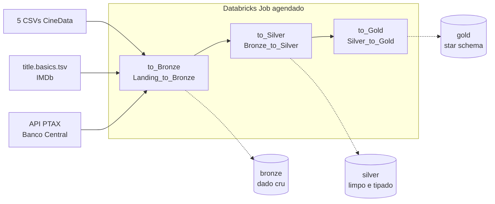
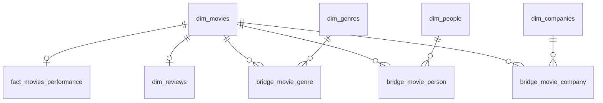

# CineData Analytics — Pipeline Medalhão no Databricks

Projeto das Atividades 2 e 3 do mini-curso Visagio Rocket Lab (2026.2). Um pipeline de dados em **PySpark + Delta Lake** no Databricks (Unity Catalog) transforma bases brutas de filmes (TMDB/IMDb) e a cotação do dólar do Banco Central em um **modelo dimensional (star schema)**, pronto para consumo de BI e para análises de negócio.

Na Atividade 3, o pipeline passou a ser **orquestrado por um Databricks Job agendado**, com três tarefas encadeadas.

## O que mudou na Atividade 3

| Tema | Atividade 2 | Atividade 3 |
|---|---|---|
| Execução | 5 notebooks rodados manualmente, em sequência | Job com 3 tarefas (`to_Bronze` → `to_Silver` → `to_Gold`), dependências explícitas e agendamento |
| Notebooks | organização, bronze, silver, gold, analytics | `Organization` (setup, fora do Job) + `Landing_to_Bronze`, `Bronze_to_Silver` e `Silver_to_Gold` |
| Datas da API | widgets lidos antes de serem criados (só funcionava com widgets já existentes) | widgets criados antes da leitura; período padrão calculado a cada execução |
| Reexecução | pensada para uma execução | Silver e Gold não duplicam registros, mesmo com a Bronze acumulando cargas |
| Domínio de gêneros | 19 gêneros oficiais do TMDB | 29 gêneros (IMDb + TMDB), com sinônimos e correção de erros de digitação |
| Saídas | `print` / `display` de inspeção ativos | saídas de inspeção comentadas; validações continuam ativas |

## Escopo

- **Ingestão** de cinco arquivos CSV com informações de filmes (metadados, financeiro, métricas de engajamento, créditos e avaliações de usuários), da cotação PTAX do dólar via API do Banco Central e da lista de gêneros do IMDb (`title.basics.tsv`), usada como domínio de referência.
- **Tratamento e padronização** de dados com problemas reais de qualidade: duplicatas, formatos de data mistos, separadores inconsistentes, valores monetários em texto (`$`, `USD`, `12.6K`), erros de escala e deslocamento de colunas (*column shift*).
- **Conversão financeira** de USD para BRL e cálculo de lucro e margem.
- **Modelagem dimensional** com chaves substitutas, tabelas ponte para atributos multivalorados e uma tabela fato com grão validado.
- **Validação analítica** do modelo por meio de perguntas de negócio.
- **Orquestração** com um Databricks Job agendado, simulando uma rotina de atualização em produção.

## Arquitetura

Tudo fica no catálogo `cinedata_medallion`, com um schema por camada:

| Camada | Schema | Conteúdo |
|---|---|---|
| Bronze | `cinedata_medallion.bronze` | Dados como vieram da origem, com o timestamp da ingestão. Modo `append`: guarda o histórico de cargas. |
| Silver | `cinedata_medallion.silver` | Dados limpos, tipados, deduplicados e com colunas em português. Modo `overwrite`. |
| Gold | `cinedata_medallion.gold` | Dimensões, pontes e fato do star schema. Modo `overwrite`. |

## Notebooks

| Notebook | Tarefa do Job | O que faz |
|---|---|---|
| `Organization` | — (setup, executado uma vez) | Cria o catálogo, os schemas `bronze`, `silver` e `gold`, e o volume `bronze.landing`, onde ficam os arquivos de origem. |
| `Landing_to_Bronze` | `to_Bronze` | Lê os CSVs e o `title.basics.tsv` do volume e grava uma tabela Delta para cada fonte, sem alterar o conteúdo. Extrai a cotação do dólar da API do Banco Central para o período dos widgets (`data_inicio` / `data_fim`, padrão: últimos 7 dias). |
| `Bronze_to_Silver` | `to_Silver` | Aplica as regras de limpeza e padronização, monta o domínio de gêneros (IMDb + TMDB) e gera a série contínua de cotação do dólar (*forward fill* para fins de semana e feriados). |
| `Silver_to_Gold` | `to_Gold` | Constrói o star schema (dimensões com chaves substitutas, tabelas ponte e a fato de performance dos filmes, com grão validado) e responde às perguntas de negócio do desafio com `display()`. |

## Orquestração (Databricks Job)

- **Tarefas e dependências:** `to_Silver` só começa depois que `to_Bronze` termina com sucesso, e `to_Gold` só depois de `to_Silver`. Uma falha interrompe a cadeia: se a API do Banco Central responder com erro, ou se o grão da fato for violado, as tarefas seguintes não rodam e o Job fica marcado como falho.
- **Agendamento:** o Job tem um agendamento periódico que simula a rotina de atualização em produção. A definição completa (tarefas, dependências e agendamento) está em [`job.yaml`](job.yaml), exportado do Databricks.
- **Sem parâmetros fixos:** o período consultado na API é calculado a cada execução pelos widgets do `Landing_to_Bronze`. Por isso, o Job não define `data_inicio` / `data_fim`.

## Como executar

1. Rode o notebook **`Organization`** uma vez, para criar a estrutura.
2. Suba os arquivos para o volume pelo menu *Catalog → cinedata_medallion → bronze → landing → Upload to this volume*:
   - os 5 CSVs da base CineData;
   - o `title.basics.tsv`, baixado de [datasets.imdbws.com](https://datasets.imdbws.com/) e descompactado (o arquivo original é `.tsv.gz`).
3. Execute o Job (*Run now*) ou aguarde o agendamento.

Para rodar sem o Job, execute os três notebooks na ordem: `Landing_to_Bronze` → `Bronze_to_Silver` → `Silver_to_Gold`.

## Reexecução

- **A Bronze cresce de propósito:** cada execução acrescenta uma nova cópia completa de cada fonte, marcada com seu `ingestion_datetime`. Em produção, esse crescimento seria controlado com ingestão incremental (`COPY INTO` ou Auto Loader) ou com uma política de retenção (`DELETE` dos lotes antigos + `VACUUM`).
- **A Silver chega ao estado atual:** cada tabela elimina as cópias vindas de cargas repetidas, mantendo a versão mais recente de cada filme, removendo duplicatas integrais ou usando só o lote mais recente, conforme a tabela. A cotação do dólar é a exceção: o histórico de cargas forma a série temporal.
- **A Gold é reconstruída inteira:** as chaves substitutas são geradas com `row_number()` ordenado pela chave natural, então os mesmos dados produzem as mesmas chaves em todas as execuções.
- **Como verificar:** rode o Job duas vezes seguidas. As contagens das tabelas Gold e as respostas das perguntas de negócio devem ser iguais, e cada tabela Bronze deve ganhar exatamente um lote novo.

## Tabelas geradas

**Bronze:** `movies_info`, `movies_financials`, `movies_metrics`, `credits_and_tags`, `movies_reviews`, `tb_cotacao_dolar`, `genres_imdb`

**Silver:** `tb_info_filmes`, `tb_financeiro_filmes`, `tb_metricas_engajamento`, `tb_avaliacoes_usuarios`, `tb_generos`, `tb_pessoas_empresas`, `tb_cotacao_dolar` e a tabela de referência `tb_generos_imdb`

**Gold:**

| Tipo | Tabelas |
|---|---|
| Dimensões | `dim_movies`, `dim_genres`, `dim_people`, `dim_companies`, `dim_reviews` |
| Pontes | `bridge_movie_genre`, `bridge_movie_person`, `bridge_movie_company` |
| Fato | `fact_movies_performance` (um registro por filme lançado) |

## Principais decisões

- **Bronze sem transformação:** todas as colunas são lidas como texto, e a tipagem fica para a Silver.
- **Conversões seguras:** `try_cast`, `try_to_timestamp` e validação por regex antes de converter, para que valores inválidos virem `NULL` sem interromper o pipeline (o Databricks opera em modo ANSI).
- **Ausência como `NULL`:** zeros e textos como `"Unknown"` que representam dado não informado viram `NULL`, para não distorcer médias, somas e lucro.
- **Domínio de gêneros:** união das listas do IMDb e do TMDB (29 gêneros). `Science Fiction` é padronizado como `Sci-Fi`, e erros de digitação são corrigidos por similaridade textual (Levenshtein normalizado ≥ 0.8). Valores ambíguos ou fora do domínio são descartados.
- **Valores monetários em `DECIMAL(18,2)`**, que tem precisão exata.
- **Chaves substitutas determinísticas:** `row_number()` ordenado pela chave natural, com partição única explícita (`Window.partitionBy(F.lit(1))`), aceitável pelo tamanho das dimensões. Pontes e fato buscam as chaves nas dimensões já gravadas.
- **Grão da fato validado com `assert`**, que interrompe a tarefa (e o Job) se houver filmes duplicados.

Os detalhes de cada regra estão documentados nas células de título dos notebooks.

## Pré-requisitos

- Workspace Databricks com Unity Catalog e permissão para criar catálogos (ou adaptar a variável `catalog` para um catálogo existente).
- Permissão para criar e agendar Jobs (Workflows).
- Acesso de saída à internet para a chamada da API do Banco Central (`olinda.bcb.gov.br`).
- Os 5 arquivos CSV da base CineData e o `title.basics.tsv` do IMDb.

## Fontes de dados

- **Base CineData (TMDB/IMDb):** arquivos fornecidos no curso.
- **Cotação do dólar:** API PTAX (Olinda) do Banco Central do Brasil.
- **Gêneros do IMDb:** [IMDb Non-Commercial Datasets](https://developer.imdb.com/non-commercial-datasets/), para uso pessoal e não comercial.
- **Gêneros do TMDB:** [lista oficial de gêneros de filmes](https://developer.themoviedb.org/reference/genre-movie-list).
